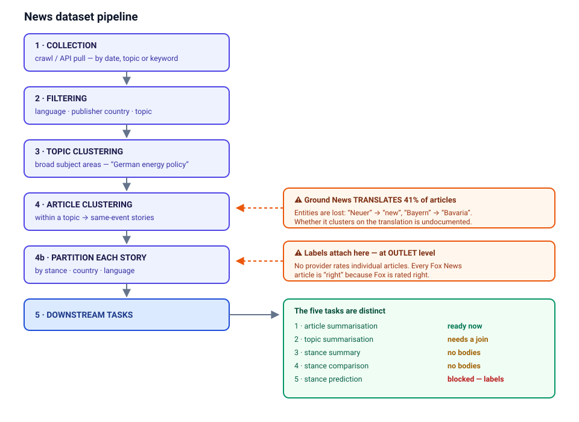

# News Sources for a German Multi-Perspective Dataset: Analysis

The written analysis for building a **German-language, multi-perspective news dataset**:
which providers exist, what each actually delivers, which keywords and API filters were
used, and what the experiments on the data found. Every number was measured on the data
on disk (Jan–Aug 2026), not taken from provider documentation.

This folder holds only the write-up and three small reproduction scripts. The code and data
for each source are in the sibling folders of the same repository:

| folder | role |
|---|---|
| [`gdelt/`](../gdelt) | GDELT: bounded dump pull → title clustering → body/image enrichment |
| [`ground-news/`](../ground-news) | Ground News: topic-page crawl, keyword search, German discovery |
| [`eventregistry/`](../eventregistry) | Event Registry: REST pull of German articles, plus the clustering evaluation |
| [`ui/`](../ui) | unifies all four sources into one format, plus a Streamlit explorer |
| `muws-allsides-dataset` (separate repo) | AllSides: roundup crawler, per-outlet scrapers, stance experiments |

## Documents

| document | what it answers |
|---|---|
| [docs/sources.md](docs/sources.md) | Per provider: how to collect, what you get, limits, images. Also ten other providers |
| [docs/keywords_and_apis.md](docs/keywords_and_apis.md) | The keywords and topic pages used, GDELT / Event Registry filters, bounded collection |
| [docs/experiments.md](docs/experiments.md) | Stance-label audit, publisher-name swap test, LLM outlier check, translation audit, clustering evaluation |
| [docs/problems.md](docs/problems.md) | The five open problems that block further research, and future directions |

## Sources compared

The first four are the ones we collected. GDELT and Event Registry are raw feeds (articles,
no political leaning); Ground News and AllSides are the platforms closest to what we want
to build, scraped to learn from their format and labels. The other ten were checked but
not collected. Sizes and per-field coverage are in [docs/sources.md](docs/sources.md).

| source | language | body text | images / video | clustering | stance label | summary | access | limitation |
|---|---|---|---|---|---|---|---|---|
| **GDELT** | multilingual (we pulled German) | none (11% via our crawl) | none native; **links scraped** by our crawl (145,078 `og:image` URLs, 88,992 captions), not downloaded; no video | none; ours, machine (title similarity, weak) | none | none | free, open, no account | no text, no labels; noisy machine topics |
| **Event Registry** | multilingual (we pulled German) | full | image **links** in the API (98.6%), not downloaded; no captions, no video | machine (`eventUri`, 16.5% of articles) | none | none | account required; free tier 2,000 tokens, then paid | **research use only, no redistribution**; free tier covers the last 30 days |
| **Ground News** | multilingual (12% German, machine-translated to English) | none (headline + dek) | none (no image field); no video | yes, method undocumented | outlet-wise (human); 37% `unknown` | machine (GPT) | free, scraped (no API, bot detection) | tiny (894 stories); translation damages names |
| **AllSides** | English | partial (17%, our scrape) | images **scraped and downloaded** (10,716 files, 8 GB; 5,306 with captions); no video | human (editorial) | outlet-wise (human) | human (editorial) | free, scraped (no API) | US only; text duplicated ~4× |
| EMM (EU JRC) | multilingual (80 languages) | unclear | not checked | machine, cross-lingual | none (framing, not left/right) | none | researcher access unclear | public NewsBrief discontinued |
| Ad Fontes | English | no (ratings only) | n/a (ratings only) | none | **article-wise (human + AI)** | none | paid licence | US-focused |
| Media Cloud | multilingual (~20 languages) | varies by source | not checked | none | none | none | free API, researcher account | archive, not stories |
| CC-NEWS | multilingual | full (raw HTML) | links inside the raw HTML; files not included | none | none | none | free, open licence | parsing, dedup and clustering all on us |
| NewsCatcher | multilingual | full | not checked | machine (Leiden) | none | none | paid (trial) | cost |
| Perigon | multilingual | full | not checked | partial (story grouping) | none | none | 150 requests/month free, then $250+/mo | 22% duplicates |
| Webz.io | multilingual | full | not checked | none | none | none | paid | 13% duplicates |
| MBFC | multilingual (international outlets) | no (ratings only) | n/a (ratings only) | none | outlet-wise (human) | none | paid API tiers | ratings only |
| NewsGuard | multilingual (EU outlets) | no (ratings only) | n/a (ratings only) | none | outlet-wise (human), trust score, not left/right | none | commercial | credibility, not stance |
| NELA-GT | English | full | not checked | none | outlet-wise (human, from MBFC) | none | free dataset | static (2018–2022), US only |

Every stance label is outlet-wise except Ad Fontes, which is English and paid. No source
combines German text, same-event clustering and article-wise stance.

## The gap

AllSides and Ground News show how one event is covered across the political spectrum, but
only for US and English-language news. Ground News includes some German outlets, yet only
through machine translation (which damages names) and with US-agency outlet ratings.
For Germany and Europe nothing comparable exists: EMM clusters news across languages but
has no notion of stance, and GDELT and Event Registry deliver articles without labels.
There is also no public dataset of German multi-outlet stories with full text, images and
stance judged per article rather than per outlet. This project would fill that gap:
daily collection of German (later European) news, grouped into same-event stories, with
text and images, and stance labels at the article level.

## Experiments

Early experiments on the collected data, in more detail in [docs/experiments.md](docs/experiments.md).

1. **Stance labels are per outlet, not per article.** AllSides and Ground News give every
   article its publisher's rating. All 15 outlets in the AllSides eval set have 100% label
   purity. A classifier trained on these labels learns the publisher: deduplicated, it gets
   72.6% on a random split but **30.9% on unseen outlets**, the same as that split's 28.1%
   majority baseline.
2. **Classifiers read the publisher's name.** Replacing the outlet name with an
   opposite-side outlet moves the prediction **+24 points** toward that side. The effect is
   asymmetric: inserting "Fox News" into centre articles moves them +51 toward right, while
   inserting "Politico" moves them only +20 toward left.
3. **An LLM agrees with the outlet label on only 50% of articles.** Fox News is the *most*
   consistent outlet (29% disagreement), and `center` articles are almost never predicted
   as centre (78% disagreement).
4. **Ground News' machine translation deletes entities** (*Neuer* → "new", *Bayern* →
   "Bavaria", *USA* → "Us"), and its topic tags are computed from the damaged text. Its
   clustering method is undocumented.
5. **Clustering (German, scored against Event Registry's event IDs):** BGE-M3 on full
   bodies reaches **0.79 F1** and TF-IDF on title + lede ties it. Our production GDELT
   clusterer scores **0.45**, missing about two-thirds of same-event pairs.

## Unified data format

The `ui/` folder converts all four sources into one JSONL schema: one line per **story**,
holding a list of **articles**, each with `stance` (left / center / right / unknown) and a
7-point `bias_rating`. The schema is in [`ui/unify/unify.py`](../ui/unify/unify.py). All 287,142
stories parse, have every field, and use only allowed values.

## Scripts

[scripts/](scripts/) reproduces three measurements: the translation audit, the LLM outlier
check and the deduplication impact. See [scripts/README.md](scripts/README.md).
